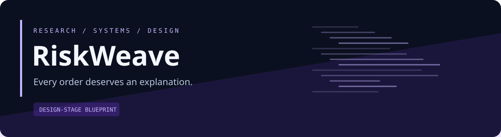
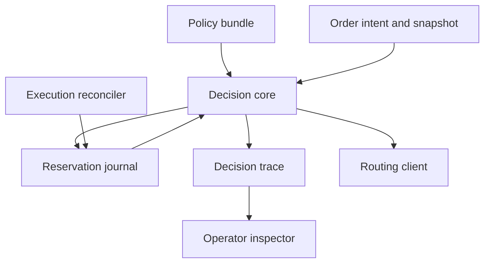

<strong>A versioned, reservation-aware risk policy engine for trading systems.</strong>

Design stage · Documentation first · Open design · No runtime implementation yet

> **Status:** This repository contains an implementation blueprint, architecture, contract specifications, and validation plan. Features below are proposed. There is no installable application, measured performance, trading track record, or completed runtime test suite in this revision. Illustrative scenarios are design examples.

## The problem

Risk checks scattered across callbacks can disagree about units, policy versions, and outstanding orders. Two individually acceptable orders may together exceed a limit. A reject message rarely explains the exact portfolio state and policy calculation that produced it.

## The proposal

Build an OCaml decision core that validates policy bundles, evaluates typed order intents against a versioned portfolio snapshot, atomically reserves exposure, and emits an inspectable decision trace. Keep the mathematical decision layer independent from broker-specific order routing.

## A concrete walkthrough

A simulated account holds 70 units of exposure under a 100-unit limit. Two incoming orders each request 20 more units. The first accepted request reserves 20; the second sees the reservation and is rejected. The operator expands the trace to inspect the position, outstanding exposure, policy version, and arithmetic. A later cancellation releases capacity only when the execution client establishes the corresponding external order state.

## Planned capabilities

| Capability | Why it matters |
| --- | --- |
| Typed policy validation | Catch incompatible units and incomplete rules before evaluating orders |
| Decision explanations | Expose inputs, intermediate calculations, and rule outcomes |
| Atomic reservations | Prevent concurrent requests from oversubscribing remaining capacity |
| Policy comparisons | Replay scenarios against revisions and explain changed decisions |
| Order-state reconciliation | Handle fills, rejects, cancels, and unknown external outcomes |
| Offline conformance fixtures | Exercise policies without a broker or sibling project |

## System map

The arrows describe proposed data or control relationships. Detailed ownership and error paths live in the architecture and pipeline specifications.

## Pipeline at a glance

| Stage | Result |
| --- | --- |
| Compile policy | Typed, validated PolicyBundle |
| Validate context | Normalized evaluation context |
| Evaluate pure rules | Ordered rule outcomes and candidate exposure |
| Reserve atomically | Accepted DecisionTrace + reservation, or revision conflict |
| Route externally | Broker action owned by caller |
| Apply lifecycle | Updated position and outstanding reservation |
| Compare revisions | Changed-decision report |

## Proposed stack

| Layer | Choice | Reason |
| --- | --- | --- |
| Decision core | OCaml + Dune | Explicit algebraic domain states and pure rule evaluation |
| Rule verification | QCheck + expect tests | Properties and readable decision traces |
| Transport | Versioned JSON over local process boundary initially | Easy cross-language audit and fixture review |
| Durable journal | SQLite through an evaluated OCaml binding | Transactional reservation and revision updates |
| Scenario generation | Python | Independent adversarial context generation |
| Inspector | Static HTML first; TypeScript UI later | Review explanation without coupling execution to a web service |

These are design decisions, not an installed dependency inventory. Exact versions, compatibility checks, and lockfiles will be added with the first implementation slice.

## First useful release

Single-account spot trading, instrument permissions, order-notional and position limits, outstanding-order reservations, stale-market-data rejection, idempotent lifecycle handling, a policy-difference report, and synthetic property scenarios.

**Explicit boundaries:** No brokerage routing inside the core, regulatory certification, options portfolio margin, cross-venue netting, derivatives liquidation modeling, or claims of mathematically complete financial safety. Complex valuation and multi-currency conversion require separately specified sources and freshness rules.

## Evidence before claims

Under the supported spot model, generated accepted-order sequences must respect configured exposure bounds including reservations. A crash-and-replay fixture must reconstruct the same accepted policy state. Pure evaluation is deterministic for the same explicitly supplied context.

## Documentation atlas

| Document | What it answers |
| --- | --- |
| [Product specification](docs/PRODUCT.md) | Users, scope, journeys, and measurable requirements |
| [Architecture](docs/ARCHITECTURE.md) | Components, ownership, state boundaries, and deployment |
| [Pipeline specification](docs/PIPELINE.md) | Stage inputs, outputs, checkpoints, and failure behavior |
| [Data model](docs/DATA_MODEL.md) | Entities, units, identities, lifecycle, and invariants |
| [Interfaces](docs/INTERFACES.md) | Integration contracts and domain-specific guarantees |
| [Experience design](docs/UX.md) | Screen behavior, navigation, and a distinctive visual direction |
| [Delivery roadmap](docs/ROADMAP.md) | Milestones with explicit exit criteria |
| [Validation and benchmarks](docs/VALIDATION.md) | Scenario matrix, correctness evidence, and measurement protocol |
| [Operations and recovery](docs/OPERATIONS.md) | Local deployment, diagnostics, recovery, and release behavior |
| [Ecosystem](docs/ECOSYSTEM.md) | Optional connections and independent operation |
| [Architecture decisions](docs/DECISIONS.md) | Choices, alternatives, consequences, and unresolved questions |
| [Source register](docs/SOURCES.md) | Primary references and implementation verification tasks |
| [Implementation handoff](docs/IMPLEMENTATION_HANDOFF.md) | Repository layout, bounded work packages, and review gates |
| [Contract conventions](docs/CONTRACTS.md) | Versioning, provenance, clocks, and numerical representation |
| [Policy and reservation lifecycle](docs/POLICY_LIFECYCLE.md) | Domain-specific protocol and worked design |

## Repository organization

| Present now | Planned with implementation |
| --- | --- |
| README, status, domain design documents | core/ |
| Original SVG identity asset | journal/ |
| Contribution and review templates | adapters/ |

See the [implementation handoff](docs/IMPLEMENTATION_HANDOFF.md) for the complete proposed module hierarchy. Planned directories are intentionally documented rather than filled with empty application scaffolding.

## Working with neighboring projects

TapeForge can supply simulated intents and lifecycle events. Execution clients can use the same decision contract. TrailLedger can retain synthetic policy comparisons and reproducible evidence without becoming the authoritative reservation store.

All integrations are optional and proposed. The [ecosystem specification](docs/ECOSYSTEM.md) records contract direction, ownership, and the suggested order of integration. A local synthetic fixture must exercise this project's core behavior independently.

## Start here

1. Read the [product scope](docs/PRODUCT.md) and the first milestone in the [roadmap](docs/ROADMAP.md).
2. Review the domain invariants in the [data model](docs/DATA_MODEL.md).
3. Select one work package from the [implementation handoff](docs/IMPLEMENTATION_HANDOFF.md).
4. Produce the associated acceptance evidence before expanding scope.

There are no installation commands yet because no executable release exists. Future setup instructions must be verified from a clean environment.

## Contributing and project state

Use [CONTRIBUTING.md](CONTRIBUTING.md) for proposals and review expectations. [STATUS.md](STATUS.md) distinguishes the completed blueprint from planned engineering work.

**License:** MIT for original repository material; see [LICENSE](LICENSE). Third-party datasets, venue content, game assets, and trademarks retain their own rights.
