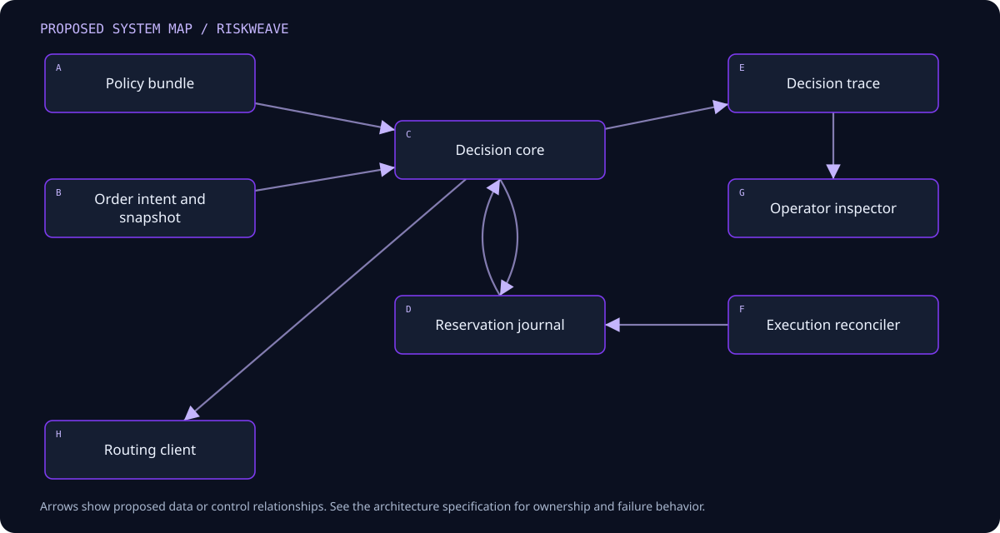

# RiskWeave — architecture

## Component boundaries



<details>
<summary>Editable Mermaid source</summary>

```text
flowchart TD
  A[Policy bundle] --> C[Decision core]
  B[Order intent and snapshot] --> C
  C --> D[Reservation journal]
  D --> C
  C --> E[Decision trace]
  F[Execution reconciler] --> D
  E --> G[Operator inspector]
  C --> H[Routing client]
```

</details>

| Component | Owns | Boundary |
| --- | --- | --- |
| Policy compiler | Rule structure, units, and version | Does not fetch live account state |
| Pure evaluator | Per-rule arithmetic and explanations | Cannot mutate reservations or route orders |
| Reservation coordinator | Revision checks and atomic exposure changes | Single transaction owner in first release |
| Lifecycle reducer | Supported order transitions and deduplication | Cannot infer success from request transmission |
| Execution client | Broker adapter and reconciliation source | Remains outside the risk core |
| Trace exporter | Decision evidence and policy diff | Read-only projection of accepted journal state |

## State, control, and computation

Separate pure evaluation from stateful acceptance. The pure function returns proposed outcomes using an immutable context. Acceptance checks the expected position/reservation revision and commits the reservation and trace together. Concurrent requests serialize through this transaction boundary; a stale request reevaluates. The core trusts only explicitly accepted context sources and freshness bounds. Positions and remaining reservations are updated coherently when fills arrive so exposure is transferred, not counted twice or lost.

## Deployment and dependency direction

The first deployment runs locally with explicit data and output directories. Domain logic must execute without a browser UI and without a sibling repository. The UI issues commands through an application boundary and reads materialized results; it never edits raw evidence or canonical domain state directly. File imports enter a staging area, validate, and only then become visible through a manifest.

Start with the fewest processes consistent with the domain. Add a process boundary when isolation, a different language runtime, or measured scheduling interference requires it. Do not introduce Kafka, Kubernetes, a shared remote database, or microservices to satisfy a diagram. Document resource limits, lock ownership, and crash recovery before adding concurrency.

## Fault containment

A missing price, incompatible scale, stale portfolio, journal write failure, or unsupported policy rule prevents acceptance when required for the decision. If an accepted intent times out while routing, its status becomes external-outcome-unknown and capacity remains reserved until reconciliation. A cancel request alone is insufficient to release capacity. Restart replays accepted journal events and compares against the execution client’s snapshot before reopening acceptance.

## Compatibility and observability

Domain interfaces are detailed in [INTERFACES.md](INTERFACES.md). Every run has an identity, a configuration fingerprint, a source revision, input references, and a terminal status. Diagnostic events link back to the smallest available unit of work. Structured logs carry correlation IDs and exclude credentials. Statistics state their units and observation windows. An operation that cannot establish input completeness must propagate that uncertainty rather than presenting a normal result.

## Extension rules

Adapters translate external formats at the boundary. They cannot redefine canonical semantics implicitly. A new source or execution adapter must pass the same fixture suite as the existing one and document unavailable capabilities. Cross-project contracts are accepted only after a synthetic round trip demonstrates version negotiation, duplicate behavior, and failure isolation.
